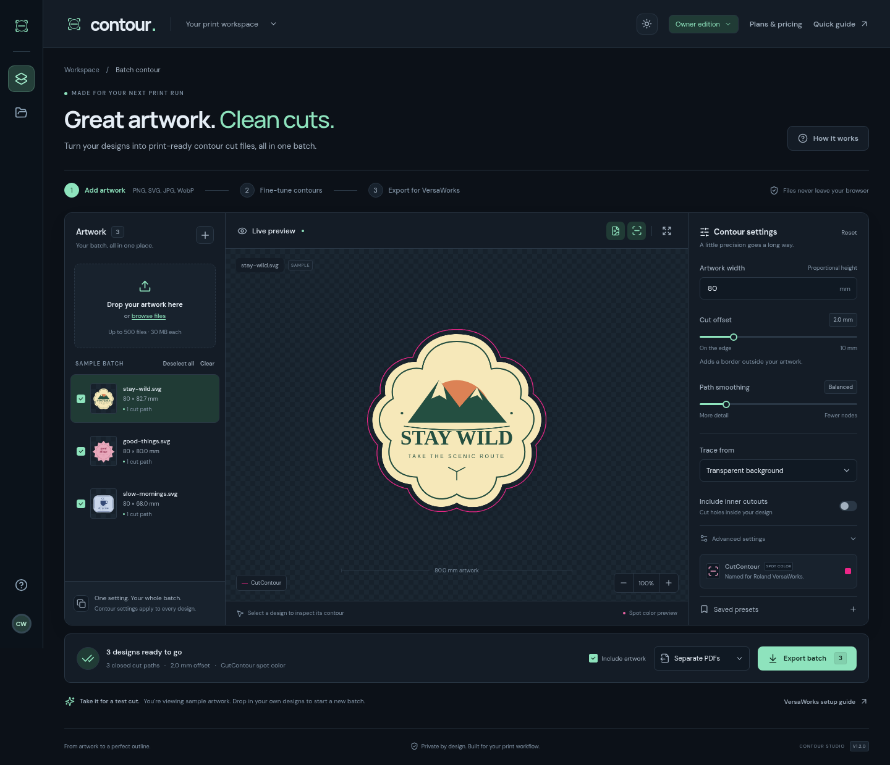

# Contour Studio

A modern dark/light workspace for creating Roland VersaWorks contour-cut PDFs in batches. Version 1.2 adds 500-design processing, progress/cancellation, smaller download volumes, saved presets, and a hosted Stripe subscription workflow.



[View the plan-pricing preview](docs/screenshots/pricing.png).

## Try the owner workspace

[Download the owner website ZIP](downloads/contour-site.zip?raw=true). Unzip it and upload the **contour-site** folder to a static host such as Netlify Drop. The footer should show **V1.2.0**. This standalone owner build runs without accounts or API keys and includes all tools for your own use. Pricing is visible for review; payments are disabled.

**The owner ZIP is not the paid customer website.** Customers using that build would have unrestricted owner access. For subscriptions and Free quotas, deploy the hosted build from GitHub using the steps below.

## Run it on Shopify

[Download the Shopify integration ZIP](downloads/contour-shopify.zip?raw=true) and [follow the installation guide](docs/SHOPIFY.md). The tool appears on a store page while the hosted app handles accounts, exports, and Stripe billing. Includes email-code sign-in for embedded pages and checkout in a separate tab. A custom app subdomain of your store gives the best embedded experience; browsers that block embedded storage get a full-workspace button.

## Launch paid customer access

[Follow the Stripe + Supabase launch guide](docs/PAID-LAUNCH.md). Netlify builds the customer site from this repository with the committed `netlify.toml`; customer auth, database rules, signed Stripe webhooks, and export APIs require your own provider configuration. A static Drop upload cannot run those APIs.

| Plan | Price | Access |
| --- | --- | --- |
| Free | CAD $0 | 5 single-design PDF exports per UTC calendar month, basic contours, live preview |
| Pro | CAD $7.99/month | Unlimited exports, batches up to 500, advanced settings, saved presets |
| Annual Pro | CAD $79.99/year | The same Pro access; saves CAD $15.89 versus 12 monthly payments |

Stripe handles payment details and the customer billing portal. Supabase provides email-link sign-in, private presets, and server-enforced usage. Payment and email flows still need testing with the owner's actual accounts before launch. No live subscriptions or charges have been created by this setup.

## Develop locally

Use Node.js 24 and npm. The default local build is the unrestricted owner edition.

```sh
npm ci
npm run dev
npm test
npm run build
npm run preview
```

For customer-mode development, copy `.env.example` to an ignored `.env.local`, configure your test accounts, and use Netlify's local Functions tooling. Never put private keys in a `VITE_` variable. See the launch guide for exact public/server settings.

## Validate

```sh
# Start a dev/preview server first, then use the matching BASE_URL.
CHROMIUM_PATH=/usr/bin/chromium BASE_URL=http://127.0.0.1:5174 npm run test:browser
CHROMIUM_PATH=/usr/bin/chromium BASE_URL=http://127.0.0.1:5174 npm run test:large
```

On another machine, install Playwright Chromium with `npx playwright install chromium` and omit `CHROMIUM_PATH`, or set it to an installed Chromium binary. Screenshots, synthetic stress-test results, and downloads are written to the ignored `.local/` directory.

`npm test` covers contour geometry, PDF resources, all 500 PDFs in bounded ZIP volumes, local artwork placement below hosted cut paths, real PostgreSQL quota/RLS rules through PGlite, and signed Stripe fixture webhooks. Provider requests in route tests are mocked; they do not establish real checkout readiness.

## Print workflow

1. Import PNG, self-contained SVG, JPG, or WebP images. The first successful real upload replaces the samples. Pro/owner workspaces support up to 500 designs; Free works with one design at a time.
2. Set the artwork width in millimeters; height stays proportional. Width includes the source image's transparent padding. Set an outward cut offset, inspect the pink preview, and optionally enable inner cutouts.
3. Use search and pagination to navigate larger batches. Select which designs to export. Use **Clear** to start a new batch without reloading. Imports and PDF exports show progress and can be stopped without clearing the artwork.
4. Separate PDFs are packaged into ZIP volumes of up to 50 designs or approximately 32 MiB of PDF data. Large A4 exports are split by a 16-million-pixel/25-design budget. Download every part shown in the results window. Uncheck **Include artwork** for cut-only output.
5. Import the original PDFs into VersaWorks at 100% scale, inspect the animated/dotted cutting line, and run a small test cut before production. Do not print the PDFs through another PDF printer, which can remove spot-color information.

The export uses PDF 1.3, a case-sensitive `/Separation /CutContour /DeviceCMYK` spot color, a bounded indirect tint function, a 0.25 pt overprinted closed stroke, and uncompressed cut commands. Transparent print pixels are flattened onto white; cut strokes remain vectors. The corrected v1.0.1 sticker PDF was confirmed working by the user in VersaWorks 7.6.1. Test representative files on your own printer, especially after enabling hosted export.

Individual PDFs include a 3 mm margin outside the artwork/cut bounds. A4 sheets use 8 mm margins and 6 mm gaps, preserve order and physical size, and do not rotate or duplicate designs. Oversized designs produce an error instead of being clipped.

## Storage, privacy, and limits

- The current release needs a modern browser with IndexedDB, web workers, `createImageBitmap`, and OffscreenCanvas. Large batches are intended for desktop browsers; capacity and processing time depend on the device and artwork.
- Source files are limited to 30 MB each. Decoding normalizes the longest edge to at most 1,400 pixels. SVG print artwork is rasterized; cut paths remain vectors. Check effective resolution before large-format printing.
- Full rasters are stored temporarily on the device. Only small thumbnails and contour results are kept in the main workspace. Workers load one source raster at a time. A session has a 1 GiB normalized-artwork budget and must also fit the browser's available disk quota. A 500-file count is not a guarantee that 500 unusually large files fit every device.
- Temporary records older than 24 hours are cleaned at startup. Reloading resets the project view; files/downloads are not a saved-project system. Download results before starting another export, reloading, or clearing browser data. Presets save settings only: up to 50 private cloud presets on Pro, or local-device presets in the owner edition.
- The owner build does not upload artwork or cut geometry. The hosted build sends cut geometry, names/dimensions, and hashes to the authorized export service; image pixels remain local and are composited below the returned vector cut PDF. Do not describe the hosted build as fully offline.
- White-background mode ignores near-white pixels for tracing. It does not segment a photograph from a complex background. Export flattens transparent/partial pixels onto white and does not preserve separate white-ink or live transparency workflows.
- Islands under four source pixels of area are discarded. Rounded offsets are unioned to prevent duplicate cutting where outlines meet. Inspect small details and narrow cutouts after smoothing.
- The source and owner archive are available to anyone who can access this repository. Hosted subscription checks do not prevent self-hosting an owner copy; review distribution and licensing before commercial launch.

## Stack

React, TypeScript, Vite, IndexedDB, and web workers; d3-contour and Clipper for geometry; pdf-lib and JSZip for output; Stripe, Supabase, and Netlify Functions for hosted subscriptions. No raw card data is handled by the app.
